<h1 align="center">ABS Player</h1>

  Audiobook clients for your own <a href="https://www.audiobookshelf.org/">Audiobookshelf</a> server:
  Android phones, Android Auto, Google TV and Windows. 
  One position across all devices, and playback you can move from one device to another.

  <a href="https://github.com/tlkounev/abs-player/releases/download/android-latest/ABS-Player-Android.apk"><b>⬇ Download for Android</b></a>
  &nbsp;·&nbsp;
  <a href="https://github.com/tlkounev/abs-player/releases/download/win-latest/ABS-Player-Setup.exe"><b>⬇ Download for Windows</b></a>
  &nbsp;·&nbsp;
  <a href="https://github.com/tlkounev/abs-player/releases">All releases</a>

  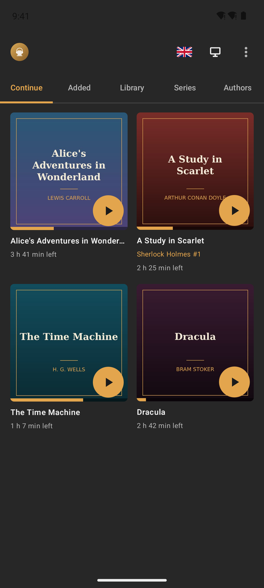
  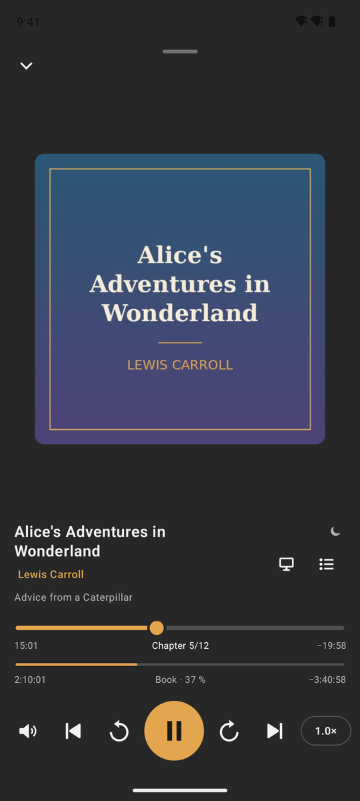
  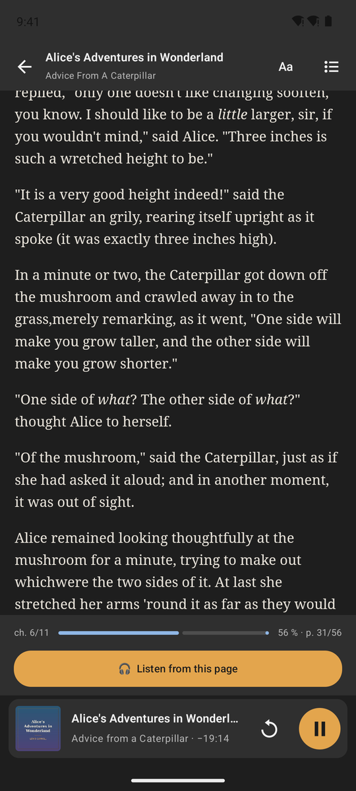

  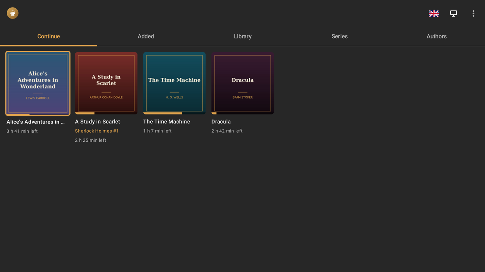

  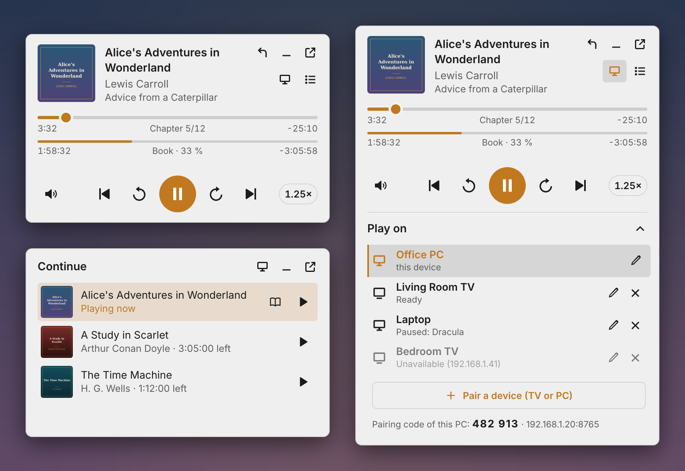

## Highlights

- **Your position, everywhere.** The Audiobookshelf server keeps whatever position it receives last.
  ABS Player saves the position the moment you pause, reads the server before resuming, and picks up
  a newer position from another device instead of overwriting it.
- **Play on another device.** Send the book from the phone or PC to the TV or another PC, with one tap.
  It continues on that device from the exact second. The phone or PC then works as its remote control.
  This works without Chromecast: the receiving app streams from your server itself.
- **Read and listen.** Books with an EPUB in Audiobookshelf open in a built-in reader.
  *Listen from this page* starts the audio at the place you are reading, and the reader can open
  where you stopped listening.
- **Chapters first.** A bar for the current chapter plus a thin bar for the whole book, both draggable.
  The chapter list can be searched by name or number. Time left follows the playback speed.
- **15 languages:** English, Czech, Slovak, German, Polish, French, Spanish, Italian, Portuguese,
  Dutch, Hungarian, Ukrainian, Russian, Chinese and Japanese.
- **Updates itself.** Both apps check this repository for a new version and install it when you confirm.

## The apps

| | Platform | Version | Download |
|---|---|---|---|
| [**Android**](android/README.md) | Phone, Android Auto, Android TV / Google TV – one APK | 1.6.4 | [ABS-Player-Android.apk](https://github.com/tlkounev/abs-player/releases/download/android-latest/ABS-Player-Android.apk) |
| [**Windows**](win/README.md) | Windows 10 / 11, tray mini player + the full Audiobookshelf web app | 1.3.2 | [ABS-Player-Setup.exe](https://github.com/tlkounev/abs-player/releases/download/win-latest/ABS-Player-Setup.exe) |

You need your own Audiobookshelf server; the apps sign in with your usual Audiobookshelf account.

### Android – phone

  
  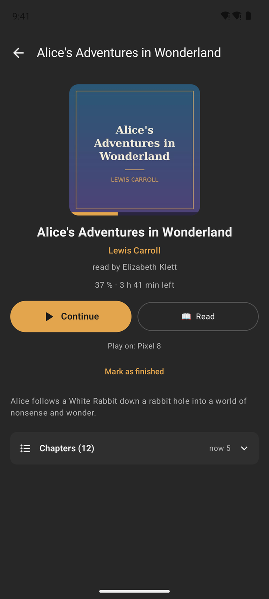
  
  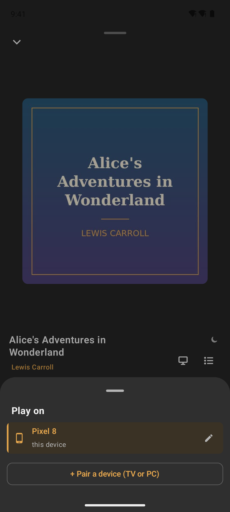

  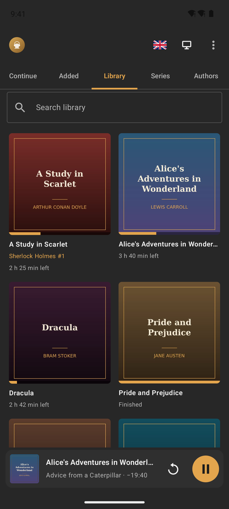
  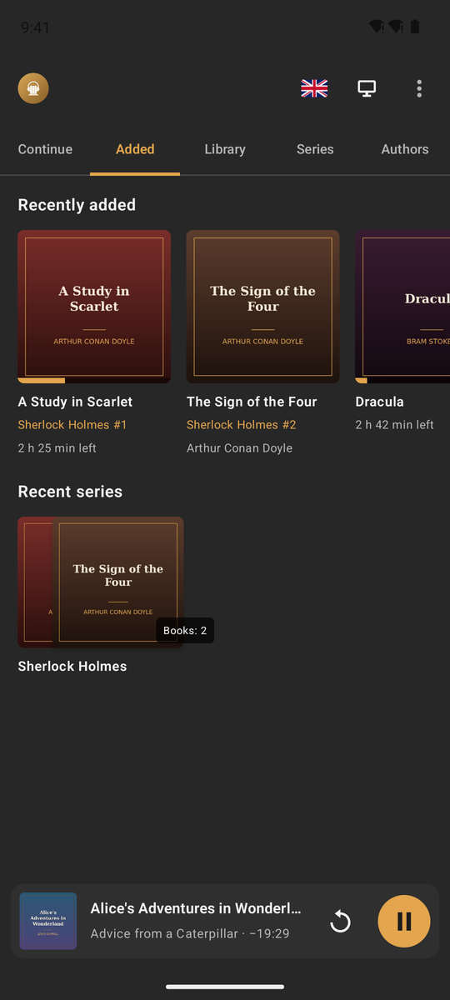
  

Tabs *Continue*, *Added*, *Library*, *Series* and *Authors*; book detail with chapters; a large player
with sleep timer, speed and volume; controls in the notification, on headphones and over Bluetooth.

### Android – Google TV

  
  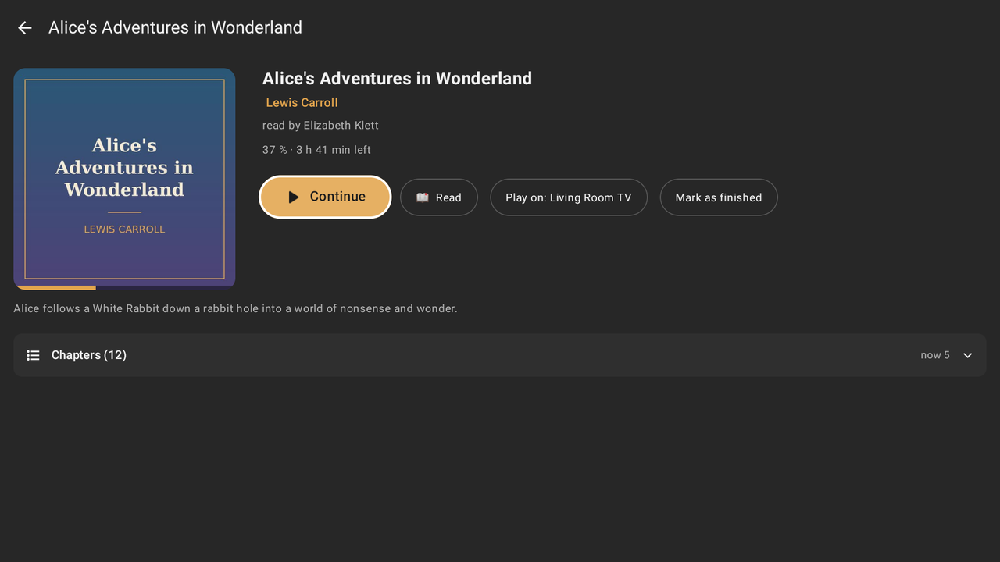

  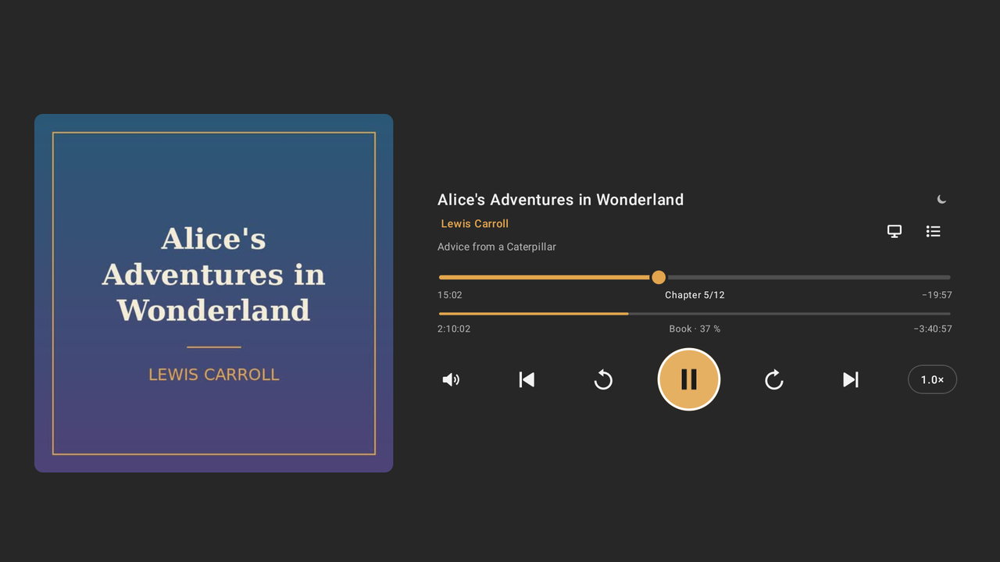
  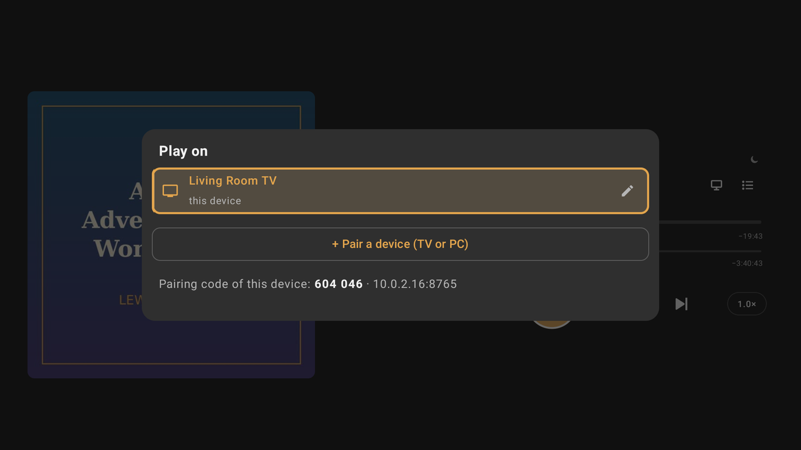

The same APK works with the remote control. It also runs a receiver in the background, so a phone
or PC can send a book to the TV, and the TV opens the player by itself.

### Android Auto

Continue, Library, Series and New, with covers and progress. In the car a book behaves like a list
of chapters: the bar shows the current chapter, ⏮ / ⏭ jump between chapters. There is voice search,
and the speed button shows the current speed.

### Windows

  
  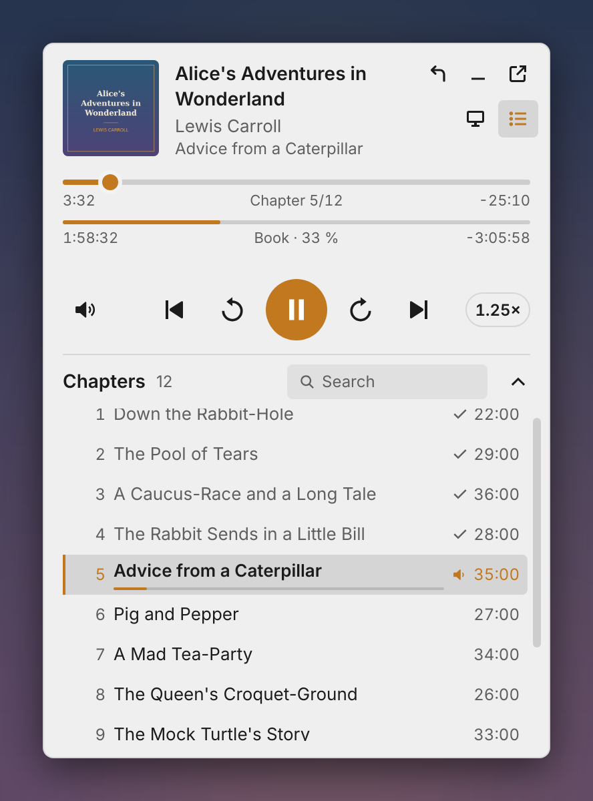

  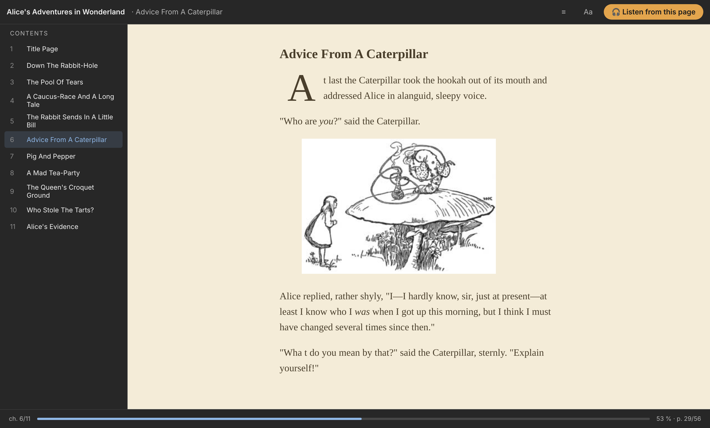

A mini player in the notification area: click the tray icon and it appears above the taskbar.
It has chapter and book bars, volume, speed, a searchable chapter list, *Continue*, and *Play on*.
Double-click the icon to open the full Audiobookshelf web app in its own window.

## Install

**Android phone** – download [ABS-Player-Android.apk](https://github.com/tlkounev/abs-player/releases/download/android-latest/ABS-Player-Android.apk)
and open it. Android asks once to allow installing apps from your browser or file manager.

**Google TV / Android TV** – install the same APK. Either `adb connect <tv-ip>` and
`adb install ABS-Player-Android.apk`, or use a file manager / *Downloader* on the TV.

**Android Auto** – apps from outside the Play Store appear in the car only after you enable unknown
sources: Android Auto settings → tap *Version* 10× → ⋮ → *Developer settings* → *Unknown sources*.

**Windows** – download [ABS-Player-Setup.exe](https://github.com/tlkounev/abs-player/releases/download/win-latest/ABS-Player-Setup.exe)
and run it. The installer is not code-signed, so SmartScreen may ask: *More info* → *Run anyway*.
On the first start enter the address of your Audiobookshelf server.

## Play on: how devices find each other

- Each receiver (TV app, Windows app) shows a 6-digit pairing code and its address in *Play on*.
- Devices are found by mDNS (`_absplayer._tcp`) and by scanning the home network (ports 8765–8774).
  You can also type the IP address.
- Switching pauses the current device, saves the position to the server and starts the receiver
  from there. The receiver streams from your Audiobookshelf server with its own sign-in.
- Everything stays on your local network: HTTP + JSON, see
  [`Protocol.kt`](android/app/src/main/java/cz/ondra/absplayer/remote/Protocol.kt) and
  [`remote.js`](win/src/remote.js).

## Repository

| Folder | Content |
|---|---|
| [`android/`](android/README.md) | Android app (Kotlin, Jetpack Compose, Media3 / ExoPlayer) |
| [`win/`](win/README.md) | Windows app (Electron) |
| [`reader/`](reader) | EPUB reader page (epub.js) shared by both apps |
| [`tools/screenshots/`](tools/screenshots) | Demo library and scripts for the screenshots above |

Every push to `main` builds the app whose folder changed (GitHub Actions) and publishes it under
[Releases](https://github.com/tlkounev/abs-player/releases): `android-v…` (APK), `win-v…`
(installer + zip). `android-latest` and `win-latest` always hold the newest build under a fixed file
name, which is what the download links above point to.

The screenshots show public-domain books on a demo server, generated by
[`.github/workflows/screenshots.yml`](.github/workflows/screenshots.yml).

ABS Player is an unofficial client; Audiobookshelf is a project of
[advplyr](https://github.com/advplyr/audiobookshelf).
