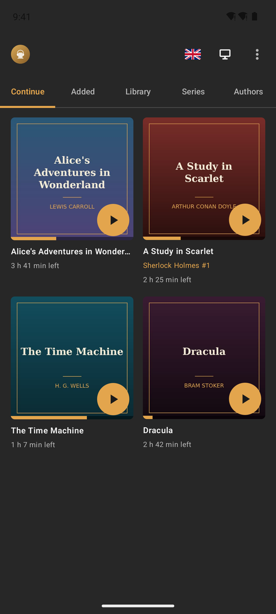
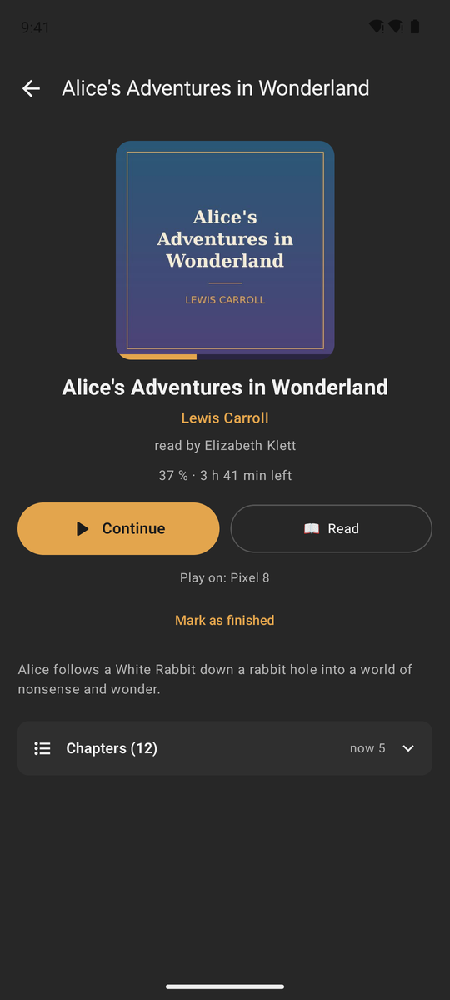
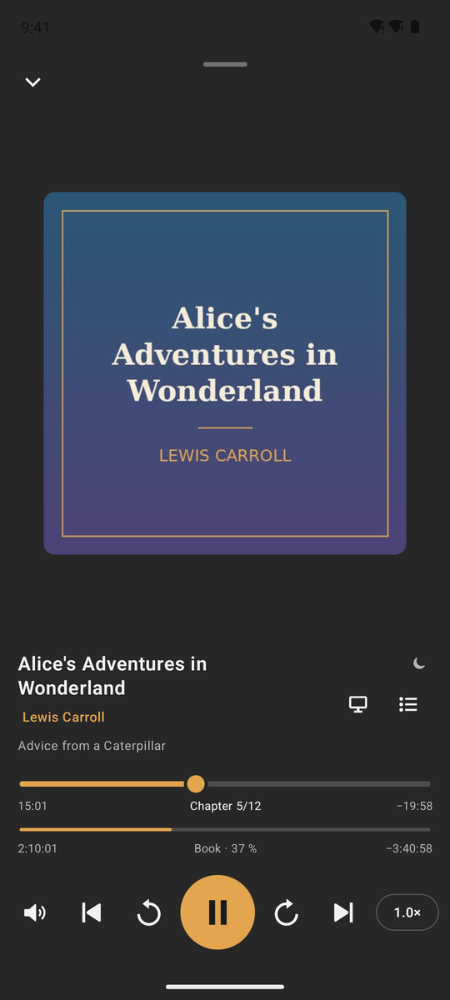
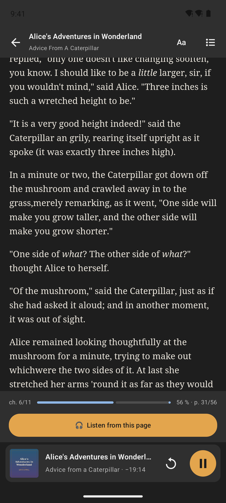
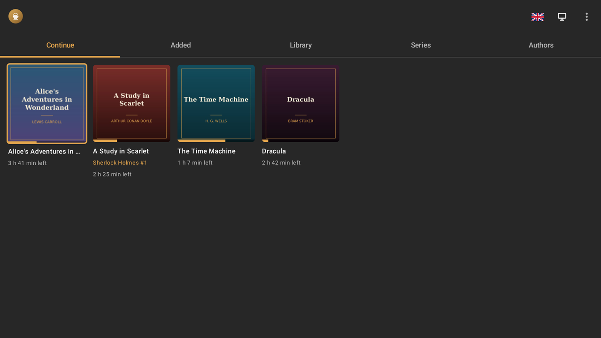
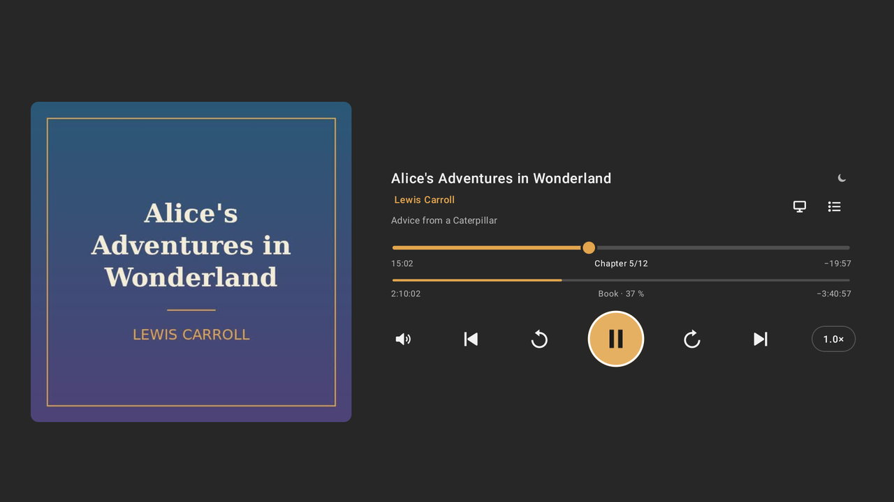

# ABS Player for Android

An Audiobookshelf client for the phone, Android Auto and Android TV / Google TV – all in one APK.
Version 1.6.4.

**[⬇ Download ABS-Player-Android.apk](https://github.com/tlkounev/abs-player/releases/download/android-latest/ABS-Player-Android.apk)**
· [all releases](https://github.com/tlkounev/abs-player/releases)

<p>
  
  
  
  
</p>
<p>
  
  
</p>

## Features

### Phone

- Tabs **Continue** (in progress on any device) | **Added** | **Library** | **Series** | **Authors**:
  - *Added* = recently added books and recent series (the same shelves as the Audiobookshelf home page);
  - Library, Series and Authors can be searched;
  - grids show the series and its number under the title (e.g. "Sherlock Holmes #2");
  - swipe left / right to switch tabs.
- **Book detail:** author and series are links (the author's books, the series in order).
  Chapters are folded behind a *Chapters (n)* row.
- **Player**, laid out like the Windows mini player:
  - a large cover; title, author · series and chapter below; sleep timer, *Play on* and the chapter list on the right;
  - a chapter bar and a thin bar for the whole book. Both can be dragged, and the labels follow while dragging.
    Times show elapsed and remaining, adjusted to the playback speed;
  - controls: volume | ⏮ | ↺10 | ▶ | ↻10 | ⏭ | speed.
- Volume: tap = mute, hold = vertical slider. Speed: tap = next step 0.75–2×, hold = − / + by 0.05.
- Chapter list with search by name (accent-insensitive) or number; sleep timer in minutes or to the end of the chapter.
- Swipe the player down (anywhere) or use the arrow to close it. A mini player stays at the bottom (↺10, ▶).
- When nothing is playing, the player offers the latest books in progress.
- Controls in the notification, on headphones and over Bluetooth.
- **15 app languages** (flag on the home page), the same as in Windows: English, Czech, Slovak,
  German, Polish, French, Spanish, Italian, Portuguese, Dutch, Hungarian, Ukrainian, Russian,
  Chinese and Japanese. Default = system language.

### Reading e-books (EPUB)

- Books that have an EPUB in Audiobookshelf get a **Read** button next to *Listen* in the book detail.
- The reader is epub.js in a WebView (the same `/reader` page as in the Windows app):
  - top: chapter, *Aa* (size, font, dark / sepia / light theme, line spacing) and contents;
  - bottom: progress, page, and **Listen from this page** – the reader stays open and a playback bar appears under the text;
  - on the TV ← / → turn pages, OK shows the bar; in *Aa* the font size changes with ← / → (the selected bar pulses).
- The reading position is saved to Audiobookshelf (`ebookLocation`, `ebookProgress`), like the web reader.
- Listening ↔ reading: the elapsed % of the audio chapter = the same % of that chapter's text (by characters).
  Chapters are matched by title or number, else by order, else by the ratio over the whole book.
- When listening and reading are at different places, the book detail offers *Read from the listening
  position* / *Listen from the reading position*.
- *Mark as finished* finishes both listening and reading; *not finished* resets both.

### Android TV / Google TV

- The same screens as on the phone, driven by the remote:
  - the focused item has an orange frame, the Play button turns white and grows;
  - book detail starts on *Continue*, the player on Play;
  - in the player ↑ / ↓ move between rows; ← / → seek 10 s on the chapter bar and 1 minute on the book bar
    (the knob of the selected bar pulses);
  - moving across the tabs switches the content right away; ↓ from the tabs or search goes to the first visible item;
  - the keyboard opens only after pressing OK in a text field.
- A **receiver** runs in the background (also after the TV is switched on). The TV's pairing code and
  address are at the bottom of *Play on*.
- When a book is sent to the TV, the app comes to the front with the player – also when it was only hidden
  behind the home screen. This needs *Display over other apps* (the *Allow* button in *Play on*; if the TV has
  no such setting: `adb shell appops set cz.ondra.absplayer SYSTEM_ALERT_WINDOW allow`).
- Leaving the app on the TV (Home, another app) pauses playback and saves the position.
  No screensaver while a book plays.

### Android Auto

- Tabs Continue | Library | Series | New, covers in a grid, progress on every book.
- In the car a book behaves like a list of chapters: the bar shows the chapter (not a 12-hour book),
  ⏮ / ⏭ jump between chapters, the queue = chapters (it starts one chapter before the current one,
  because Android Auto always opens it at the top).
- Buttons as in the official app: ⏯ ↺10 ↻10 | speed ⏮ ⏭. The speed button shows the current value
  (e.g. 1.25x); tap = next step 0.75–2×. Voice and text search.
- The playback screen itself (colours from the cover, wavy bar, layout) is drawn by Android Auto;
  the app only supplies data, cover and buttons, so it looks like every other player.
- *Continue* after connecting the car resumes the last book.

### Play on – TV and PC

- The target can be a Google TV (this APK) or a PC with ABS Player for Windows 1.1.4+.
- The device list looks like the Windows one: this device first (orange stripe, "this device"),
  paired devices with ×, each one can be renamed with the pencil. A new name for this device is seen by
  the others (on the next discovery / pairing); the name of a paired device applies only here.
- *+ Pair a device* opens the form right in the list; the other device shows a 6-digit code.
  IP | port | code sit in one row.
- Switching moves the book right away (also when paused) and opens the player.
  The phone then works as a remote (state, chapters, speed, sleep timer). Switching back works the same way.
- On the first start the app asks for *Nearby devices* – without it newer Android versions keep the app off the home network.
- Devices are found by mDNS and by asking every address of the home network (ports 8765–8774), so they
  are found also where mDNS does not work. After typing an IP the app finds the port itself.
  When a receiver moves to another port (8765 taken on the TV → 8766), paired devices find it again;
  mDNS records are verified before use.
- The Audiobookshelf password is needed only for a TV that is not signed in to your account yet.
- The TV plays from the server itself (own sign-in, own sync) – no Chromecast.

## Position sync

The Audiobookshelf server stores whatever position it receives last, without comparing times. So the app:

1. Reads the server position before every start / resume. When it differs from what the app wrote last,
   another client moved it → the app takes it over ("Position taken over from: …").
2. While paused, it follows the server's live events (socket) and takes positions over immediately.
3. While playing, it sends the position every 10 s and right away on pause, seek, stop and end of book.
4. When sync fails (no signal), it keeps the position locally and retries; on the next open of the book
   it wins if it is newer than the server's.
5. A dropped stream (tunnel) is reconnected up to 5×; up to 15 minutes are buffered ahead.

Note: another app (the official app, the web) can still write an old position if it resumes from it.
This app never overwrites a newer position with an older one.

## Updates

- The version is in the ⋮ menu on the home page, together with *Check for updates* (also on the TV).
- On start (at most once a day) the app looks at the GitHub releases (`android-v…`). When there is a newer
  version, a bar *Version … is available* appears at the top; ✕ hides it until the next version.
- *Update* downloads the APK and hands it to the Android installer, which asks for confirmation.
  The first time Android asks to allow installing unknown apps for ABS Player.
- Works because the repository is public and every release APK is signed with the same key.

## Install

- **Phone:** install [ABS-Player-Android.apk](https://github.com/tlkounev/abs-player/releases/download/android-latest/ABS-Player-Android.apk).
- **Android Auto:** apps installed outside the Play Store appear in the car only after enabling unknown sources.
  On the phone: Settings → search "Android Auto" → scroll down and tap *Version* 10× → confirm developer mode →
  ⋮ → *Developer settings* → *Unknown sources*.
- **Google TV:** `adb connect <tv-ip>` and `adb install ABS-Player-Android.apk` (or a file manager on the TV).
  The app appears in the apps row.

## Limitations

- Audiobooks only (no podcasts), no offline downloads (streams with a large buffer).
- *Play on* works on the local network (mDNS + HTTP, port 8765+), not from outside over mobile data.
- The phone itself is not a receiver (Android does not let a background app start playback); after
  opening it and pressing play it always takes over the latest position from the PC / TV.
- If the TV is in another VLAN, type its IP when pairing.

## Build

Requires Android Studio (Ladybug or newer) or JDK 17+ and Android SDK 35.

```
./gradlew assembleRelease
```

A locally built APK is signed with the debug key. Every push to `main` that changes `android/` (or `reader/`)
builds the APK on GitHub Actions and signs it with a fixed key from the repository secrets:

- `ANDROID_KEYSTORE_B64` – the keystore (PKCS12, alias `absplayer`) in base64,
- `ANDROID_KEYSTORE_PASSWORD` – the password of the keystore and the key.

Without them the APK is signed with a debug key and no release (`android-v…` tag) is created, because such an
APK cannot be installed over the previous version.

App texts live in `i18n/strings.py`; `python3 i18n/gen.py` generates `I18nData.kt` from them.

## Code map

- `data/` – Audiobookshelf API client (JWT access / refresh tokens, older servers with a permanent token), socket.io.
- `player/ChapterPlayer.kt` – player facade: a book as a playlist of chapters.
- `player/SyncManager.kt` – the sync rules above.
- `player/PlayerEngine.kt` – ExoPlayer + sync + sleep timer, shared by phone and TV.
- `player/PlaybackService.kt`, `BrowseTree.kt` – notification and Android Auto.
- `remote/` – playback targets (phone / TV / PC), pairing, discovery.
- `tv/` – the TV receiver (service, HTTP API, start after boot).
- `ui/ReaderScreen.kt` + [`/reader`](../reader) – the EPUB reader.
