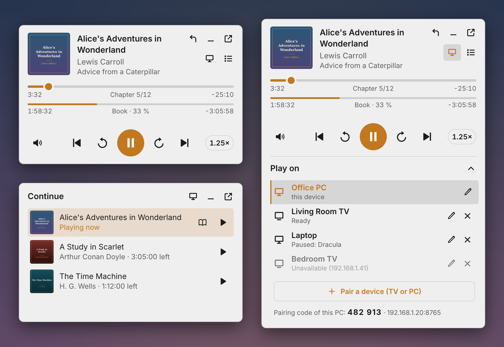
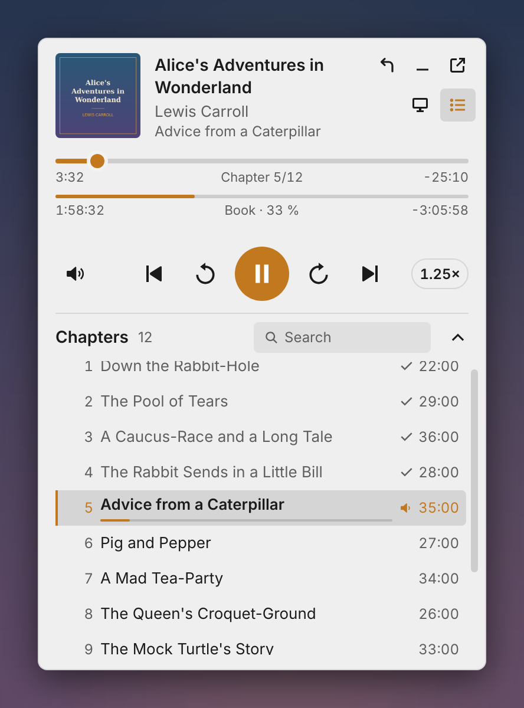
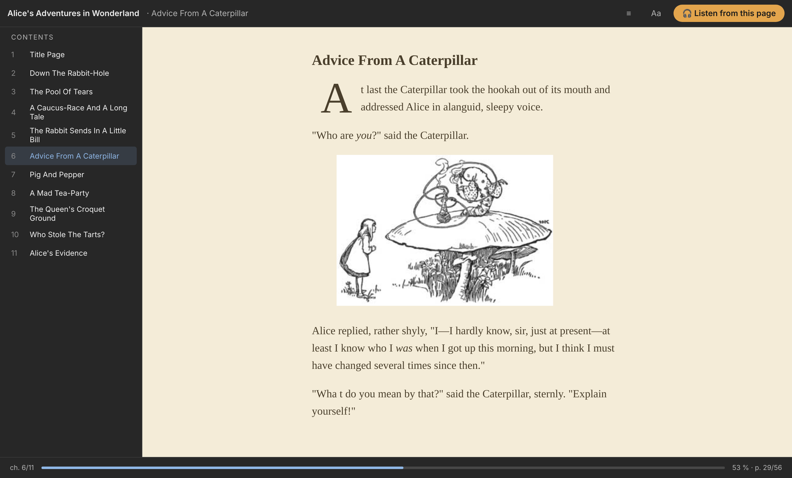

# ABS Player for Windows

The Audiobookshelf web client as a desktop app with a mini player in the Windows notification area.
Version 1.3.2.

**[⬇ Download ABS-Player-Setup.exe](https://github.com/tlkounev/abs-player/releases/download/win-latest/ABS-Player-Setup.exe)**
· [all releases](https://github.com/tlkounev/abs-player/releases)

<p>
  
  
</p>
<p>
  
</p>

The installer is not code-signed, so SmartScreen may ask: *More info* → *Run anyway*.
On the first start enter the address of your Audiobookshelf server and sign in as usual.

## Tray icon

- **Click** → show / hide the mini player.
- **Double-click** → the full Audiobookshelf window.
- **Closing the full window** hides it to the tray; playback continues.
- **Right-click** → menu: open, play / pause, *Play on*, change server, language, start at sign-in,
  check for updates, quit.

## Mini player

- Stays open when you click elsewhere. Hide it with the tray icon, the `_` button or Esc.
- Drag it anywhere outside the buttons; its position is remembered (also after a restart).
- Two progress bars: the top one = current chapter, the thin one = whole book. Both can be dragged.
  A book without chapters has one bar.
- Volume: click = mute / unmute, hover or focus = vertical slider, mouse wheel = ±5 %.
- Speed: click = next step (0.75–2×), mouse wheel = ±0.05.
- Keys: Space = play / pause, ← / → = jump, M = mute, Enter = full window, Esc = hide.
- **Chapter list:** the list button under *Open full window*, or click *Chapter x/y*. The window grows up
  (down when it sits at the top of the screen), the list scrolls to the current chapter, finished chapters
  have a tick, a click jumps to the chapter, *Search* filters by name (accent-insensitive) or number.
  Esc clears the search / closes the list.
- **Continue:** when nothing plays, the mini player shows the latest books in progress. While playing, the
  curved back arrow at the top right opens the same list: the playing book is first and highlighted
  (click it or Esc = back to the player), a click on another book plays it from its position.
  Books with an EPUB have a book icon before ▶ that opens the reader.

## Play on (TV, another PC) – and from the phone to this PC

- The monitor button in the mini player (or tray menu → *Play on*) opens the device list.
- **Switching:** the current book is paused, its position saved to the server, and playback continues on
  the selected device from exactly there. The mini player then controls that device (bars, chapters, speed,
  volume) and shows its name under the author. Select this PC to switch back.
- **Pairing:** *+ Pair a device (TV or PC)* opens the form (× / Esc closes it). Devices on the network are
  found automatically (mDNS, network scan), or type the IP. Enter the 6-digit code shown by the other device.
  A TV that is not signed in to your account yet also asks for the Audiobookshelf password (it gets its own
  sign-in; the password is not stored).
- **Finding a receiver:** when nothing answers on the given port, ports 8765–8774 are tried (the TV takes the
  first free one). A paired device that moved to another port is found again automatically.
- **Renaming:** the pencil turns the row into a field (Enter saves, Esc cancels). The name of this PC is sent
  to the other devices; the name of a paired device applies only here.
- **This PC as a receiver:** a phone with ABS Player can send playback here. The pairing code and address
  (IP:port) of this PC are at the bottom of the device list and in the tray menu. Port 8765 – on the first
  start Windows asks whether to allow network access: allow it for private networks.
- **TV switched off:** when the selected TV is unreachable, the mini player offers *Play on this device*
  (plays here from the position saved on the server). Selecting a TV that is off sends Wake-on-LAN (the app
  learns the TV's MAC address from ARP while the TV is on; the TV must have wake on network / Wi-Fi enabled)
  and waits 30 s (*Waking up …*). If the TV comes up, the book starts there; otherwise it keeps playing here.

## Reading e-books (EPUB)

A reader window with the same `/reader` page as the Android app (epub.js): contents on the left, chapter,
*Aa* (size, font, theme, line spacing) and **Listen from this page** at the top, progress and page at the bottom.
Turn pages with the arrow keys, PageUp / PageDown, the mouse wheel or a click on the left / right side.
Two pages side by side when the window is wide enough. The position is saved to Audiobookshelf like in the
web reader. *Listen from this page* starts the audio at that place; the reader stays open and the mini player
appears. Open it with the book icon in *Continue* (books with an EPUB only).

## Position sync

The Audiobookshelf web player does not save the position on pause, and after a pause it resumes from its own
old position even when you listened elsewhere in the meantime (and overwrites the newer one). The app fixes
this the same way as ABS Player for Android:

- on pause it saves the position to the server immediately,
- before resuming it reads the server position and takes it over when another device moved it,
- while paused it takes over a change from another device immediately ("Position taken over …").

## Languages

English, Czech, Slovak, German, Polish, French, Spanish, Italian, Portuguese, Dutch, Hungarian, Ukrainian,
Russian, Chinese and Japanese. The default follows Windows; change it with the flag in the server window or in
the tray menu (*Language*). This is the app language; the language of the Audiobookshelf web app itself is set
in Audiobookshelf.

## Updates

- The tray menu shows the version and *Check for updates* at the top.
- On start and then every 6 hours the app checks for a newer version; it downloads nothing by itself.
- When there is one, a Windows notification *Version … is available* appears: click = download, install
  silently and restart the app. The tray menu offers the same (*Download and install version …*).
- Source: the `win-latest` release on GitHub (`latest.yml` + installer), refreshed by GitHub Actions after
  every build.

## How it works

The main window is Chromium (Electron) with the Audiobookshelf web app in a persistent session (you stay
signed in). The mini player calls the Vue components of the web player directly (MediaPlayerContainer,
PlayerUi, VolumeControl), so it behaves exactly like the web controls, including progress sync and saved
volume / speed.

Settings: `%APPDATA%\ABS Player\config.json` (server, language, window positions, paired devices).
On the first start, settings and sign-in from the earlier version (Audiobookshelf Tray) are taken over;
uninstall that one afterwards, otherwise both would run.

The app and tray icon is the original Audiobookshelf logo (`assets/abs-logo.svg` from the
advplyr/audiobookshelf repository); `npm run icons` generates the ICO files.

## Build

```
npm install
npm start          # run for development
npm run dist       # icons + flags + installer and zip in dist/
npm test           # automated tests against a mock of the Audiobookshelf player (screenshots in test/out/)
```

The Windows installer can also be built on Linux (electron-builder needs Wine).
